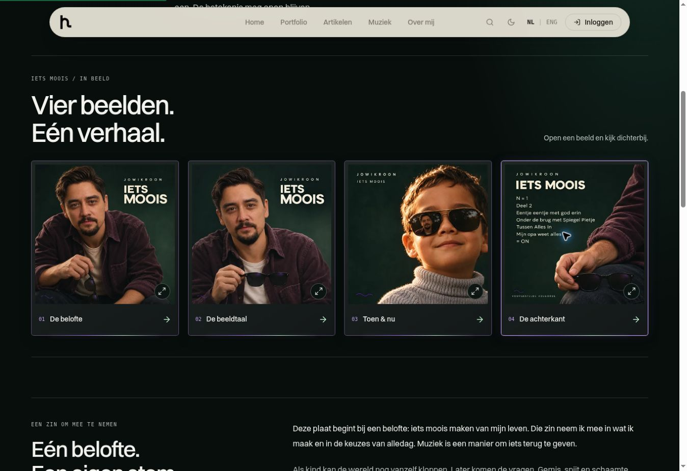
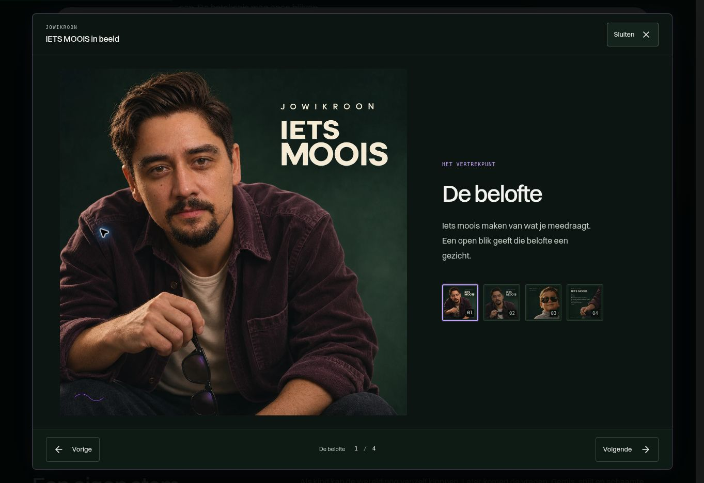

# IETS MOOIS — het verhaal in beeld

Implementatie- en validatieregister, 5 november 2026.

## Ervaring

Op `/music/albums/iets-moois/brand` staan vier beeldknoppen vóór het bestaande albumverhaal. Een dunne paarse/groene lichtlijn geeft de knoppen hun neonaccent. De aangeleverde composities blijven volledig zichtbaar; de interface legt geen tekst over het artwork.

Elke knop opent het gekozen beeld in dezelfde Radix-modal. De bezoeker kan rechtstreeks een thumbnail kiezen of cyclisch bladeren met Vorige, Volgende, de pijltoetsen, Home en End. Er is geen autoplay of geluid. Op mobiel vult de modal het scherm, met een scrollende inhoud en bereikbare bediening boven en onder het beeld.

| Beeld | Uitgangspunt | Betekenis |
| --- | --- | --- |
| De belofte | Het vertrekpunt | Iets moois maken van wat je meedraagt. |
| De beeldtaal | Rust in kleur | Diepgroen, bordeaux, warm licht en een klein paars signaal. |
| Toen & nu | Ruimte voor betekenis | De spiegeling verbindt twee leeftijden en laat interpretatie open. |
| De achterkant | Een ontwerp in wording | De afgebeelde volgorde is uitdrukkelijk een voorstel. |

Elk beeld heeft maximaal twee verklarende zinnen. De alternatieve tekst van de achterkant bevat ook de zichtbare voorgestelde songtitels.

### Gedrag en onderhoud

- De selectie staat in `?beeld=de-belofte`, `de-beeldtaal`, `toen-en-nu` of `de-achterkant`. Een onbekende waarde opent geen modal.
- Openen voegt één geschiedenisstap toe; beeldwissels vervangen die stap. Back sluit een hier geopende modal. Een directe afbeeldingslink sluit op de albumroute, zonder een onbekende vorige pagina te openen.
- Sluiten en Escape herstellen focus naar de opener. Bij een directe link krijgt de bijbehorende beeldknop focus.
- Een nieuwe selectie zet de interne scrollpositie terug naar het artwork. Selectie vanuit de scrollende thumbnails verplaatst focus naar de vaste knop Volgende.
- Een guard voorkomt dat herhaald sluiten meerdere geschiedenisstappen teruggaat. Bestaande queryparameters en het leesanker blijven behouden.
- Beeldfouten worden per afbeelding bijgehouden. Opnieuw proberen, bladeren en sluiten blijven beschikbaar.
- De modal gebruikt laag 10001 boven backdrop 10000, zodat de bestaande cookiebanner op laag 9999 de bediening niet bedekt.
- Zolang de modal open is, wordt de app-root `inert`. Ook later verschijnende achtergrondbediening blijft daardoor buiten de modalinteractie; de eerdere inert-status wordt bij sluiten of unmount behouden.
- Korte brede schermen krijgen een schermvullende modal met compacte header/footer en een passend volledig beeld. Bij maximaal 360px breedte gebruiken de bladerknoppen iconen, met hun toegankelijke namen intact.
- Bewerk bijschriften en alternatieve teksten in het databestand. Houd de afbeeldings-ID's stabiel, omdat directe links ze gebruiken.

## Bronnen en uitgevoerde controles

| Code | Bewijs |
| --- | --- |
| C | [AlbumVisualStory.tsx](../apps/personal/src/components/music/AlbumVisualStory.tsx): modal, geschiedenis, selectie, focus en foutherstel. |
| S | [music-album-visual-story.css](../apps/personal/src/styles/music-album-visual-story.css): volledige beelden, responsive indeling, focusranden en systeemvoorkeuren. |
| D | [albumVisualStory.ts](../apps/personal/src/data/albumVisualStory.ts): vier beelden, maximaal twee zinnen en volledige achterkant-alttekst. |
| P | [MusicAlbumBrand.tsx](../apps/personal/src/pages/MusicAlbumBrand.tsx): integratie uitsluitend bij IETS MOOIS; het overige albumverhaal blijft aanwezig. |
| T | [AlbumVisualStory.test.tsx](../apps/personal/src/components/music/AlbumVisualStory.test.tsx): 29 componenttests geslaagd in Vitest/JSDOM; runlog `gallery-tests-inert-regression.txt`, inclusief inert-herstel en behoud van een al bestaande inert-status. |
| A | `asset-evidence.json`: onafhankelijke decode en reproductie van vier volledige WebP's van 1254×1254 en vier thumbnails van 480×480; alle acht behouden de volledige compositie. |
| G | `final-personal-tests.txt`: 49 testbestanden, 490 tests geslaagd. Finale lintmeting, `final-personal-lint.txt`: exit 0, 0 fouten en 19 bestaande waarschuwingen. |
| B | `build-layout-final.txt`: productiebuild na de layoutcorrecties geslaagd; prerender- en webrootguards groen, SEO-guard 70 pagina's, image-guard 82 unieke beelden zonder fouten, eager bundle 416kB gzip binnen 425kB-budget. Definitieve CI/publicatie staat bij ronde 60. |
| Y | `final-personal-tsconfig-app.txt` en `final-validation-summary.json`: de finale bron inclusief browsercorrecties heeft exact dezelfde 255 TypeScript-diagnostieken als baseline `43c68aac748f60365adba5f35a6d6717b18ff6ab`, zonder nieuwe, verdwenen of galerijdiagnostieken. Exit 2 betekent dat de volledige app-typecheck **niet** geslaagd is. |
| K | `contrast-evidence.json`: 23 gedeclareerde kleurcombinaties doorgerekend, inclusief alpha-compositie en conservatieve gradient-/afbeeldingsgrenzen; geen onderschrijding bij vereiste tekst-, focus- of selectie-informatie. |
| R | Native browserwaarnemingen en responsive browserframes van dezelfde build, hieronder vastgelegd. Dit zijn echte browsermetingen; de tekstvergrotingsproef is apart als simulatie benoemd. |

De genoemde runlogs zijn bewijsnamen uit de uitvoering; ze worden hier niet als gepubliceerde downloads voorgesteld. De tests en bronbestanden hierboven zijn rechtstreeks in de repository te inspecteren. `final-validation-summary.json` koppelt de finale tests, lint en typecheck aan SHA-256-hashes van de vijf huidige galerijbestanden, inclusief de inert- en layoutcorrecties. Baseline en finale typecheck gebruiken dezelfde configuratie, lockfile en dependency-installatie; alleen het werkdirectoryvoorvoegsel in diagnostiek is genormaliseerd. Definitieve CI en release worden afzonderlijk bij PR #484 gecontroleerd.

De vier volledige WebP's zijn samen 729.336 bytes; de thumbnails samen 92.990 bytes. Dit zijn gecomprimeerde webversies: reproductie van dezelfde conversie bewijst de bronmapping en het ontbreken van uitsneden, geen verliesloze pixelgelijkheid met de PNG's.

Reproduceerbare opdrachten vanuit de repository-root:

```sh
npm run test --workspace=@hans/personal -- src/components/music/AlbumVisualStory.test.tsx
npm run test --workspace=@hans/personal
npm run build:personal
```

### Vastgelegde browserresultaten

De desktopcontrole gebruikte native muis- en toetsenbordinvoer. De verschillende schermmaten zijn daarnaast gemeten in responsive browserframes van dezelfde build; er is geen fysieke telefoon- of tabletproef uitgevoerd.

| Viewport / proef | Waargenomen geometrie en resultaat |
| --- | --- |
| Desktopcontrole | Modal 1240×884px; hoofdbeeld volledig vierkant, 672×672px. |
| 390×844px | Hoofdbeeld 343×343px; body 696px hoog; geen horizontale overflow. |
| 320×568px | Body 420px hoog met 592px scrollinhoud. Native Tab naar een thumbnail scrolde naar 172px; Enter selecteerde het beeld, herstelde scrollTop 0 en gaf focus aan Volgende. |
| 844×390px, na herstel | Hoofdbeeld 236×236px; bodyhoogte en scrollhoogte beide 262px. Artwork en bediening passen volledig. |
| 768×900px | Modal 720×584px; hoofdbeeld 380×380px; body 424px; geen overflow. |
| 1024×768px | Modal 976×716px; hoofdbeeld 504×504px; body 556px. |
| 1280×800px | Modal 1232×748px; hoofdbeeld 536×536px; body 588px. |
| 320px breed, CSS-tekst 2× | Na herstel: clientWidth en scrollWidth beide 320px; navigatieknoppen 48×48px en sluiten 128×56px. Dit is een tekstsimulatie, geen native 200%/400%-browserzoom. |

De geopende modal bleef werken bij alle genoemde viewportwissels. Native Shift+Tab vanaf Sluiten ging naar Volgende; Tab vanaf Volgende ging terug naar Sluiten. Pijltoetsnavigatie werkte. Enter opende en sloot; Spatie sloot. Browser-Back sloot de modal, Forward heropende het geselecteerde beeld en Escape herstelde focus. Een sleepbeweging vanuit de inhoud, van 400,400 naar 20,400, liet de modal open; een afzonderlijke klik op backdropcoördinaat 20,20 sloot vervolgens naar de exacte opener. Een directe achterkantlink sloot naar de albumverhaalroute met `#album-world` en focus op Bekijk de achterkant.

Na het sluiten was `root.inert=false` en keerde focus na Radix-cleanup terug naar de opener. Native navigatie van album naar verhaal werkte: terug op het verhaal waren vier beeldknoppen, geen open modal en geen achtergebleven inert-root.

Een echt ontbrekend bronbestand is in uitsluitend de testpreview nagebootst door de achterkant tijdelijk te hernoemen. De browser toonde de foutmelding, retry en navigatiecontrols. Na herstel van het bestand ververste de preview automatisch en laadde het beeld op 1254×1254px. Een handmatige browserklik op retry is daardoor niet uitgevoerd; die actie is wel unitgetest. Offlinegedrag en concrete HTTP-statuscodes worden niet uit deze proef afgeleid.

Bij native muisbediening bleef de achterliggende pagina vóór openen, tijdens de modal en na sluiten op scrollpositie 664px. Een eerder gemeten verschuiving van 25px kwam van automatisch scrollen door de gebruikte locator; die meting is niet als productfout geboekt. De expliciete focusafhandeling gebruikt `preventScroll`.

Drie browserbevindingen leidden tot gerichte correcties:

| Gevonden probleem | Correctie en nieuwe observatie |
| --- | --- |
| In landschap werd een beeld van 440px aanvankelijk afgekapt. | Schermvullende modal op korte brede schermen, compacte bediening en aangepaste beeldbegrenzing; bij 844×390px past het volledige beeld van 236px zonder bodyscroll. |
| Bij 320px en dubbele tekstbreedte liep de volgende-knop tot x333, buiten het scherm. | Iconen zonder zichtbare tekst bij maximaal 360px, met ongewijzigde toegankelijke labels; scrollWidth is opnieuw 320px en beide knoppen zijn 48×48px. |
| Een na 1,5 seconde verschijnende cookiebanner lekte in de toegankelijkheidsboom, ondanks de bestaande Radix-isolatie. | Inert-lifecycle op `#root`; browsercontrole bevestigde een gemounte banner, `root.inert=true` en uitsluitend de modal in de toegankelijke weergave. T bevat twee aanvullende regressietests. |

K gebruikt de [W3C-contrastregels](https://www.w3.org/WAI/WCAG22/Understanding/contrast-minimum.html) en [regels voor niet-tekstcontrast](https://www.w3.org/WAI/WCAG22/Understanding/non-text-contrast.html). De laagste gewone tekstwaarde is 5,50:1; de focusrand haalt minimaal 6,26:1 en de geselecteerde thumbnailrand 7,00:1. De kleurwaarden zijn bij de layoutcorrecties ongewijzigd gebleven. Decoratieve knopranden zijn niet ten onrechte als verplichte controlcontour behandeld. Dit is een berekening uit CSS, geen computed-style- of screenshotmeting.

### Browserbeelden van gecontroleerde build

Deze screenshots zijn afkomstig van de gecontroleerde lokale statische build met dezelfde bronbestanden. Ze worden niet als productiebeelden gepresenteerd.





De definitieve CI-, merge- en productiebevindingen worden vastgelegd bij [PR #484](https://github.com/jowikroon/hans-crafted-stories/pull/484). Een geslaagde lokale build of screenshot bewijst op zichzelf geen productiepublicatie.

## Register: 30 bouwcontroles, 10 stresstests, 20 herstelcontroles

Dit register telt 60 afzonderlijke controlepunten, geen 60 onafhankelijke codeversies of gebruikerstests. Een herstelcontrole kan een gevonden fout bevestigen zonder een nieuwe wijziging nodig te hebben.

**BRON** betekent dat de code of het assetbewijs is gecontroleerd. **BEREKEND** verwijst naar de doorgerekende CSS-kleuren. **UNIT PASS** betekent een geslaagde geautomatiseerde componenttest. **BROWSER PASS** verwijst uitsluitend naar de concreet beschreven native/browserwaarneming. **DEELS** benoemt zowel het beschikbare bewijs als de ontbrekende controle. **PENDING** betekent dat de beschreven controle nog niet is uitgevoerd. JSDOM bewijst geen visuele layout of native bediening; browserframes bewijzen geen fysieke aanraak- of schermlezerervaring.

### Ronden 1–30 — ontwerp en bouw

| # | Controle | Status | Werkelijk bewijs / resterende verificatie |
| --- | --- | --- | --- |
| 1 | Juiste album en plaats | BRON | P voegt de galerij alleen voor `iets-moois` toe, vóór `album-origin`. |
| 2 | Vier juiste bronbeelden | BRON | A bevestigt vier bronbestanden en acht correct gekoppelde webversies; T opent iedere titel afzonderlijk. |
| 3 | Volledige compositie | BROWSER PASS | A bevestigt geen crop; R toont volledige vierkante hoofdbeelden op desktop, mobiel en hersteld landschap. |
| 4 | Passende uitgangspunten | BRON | D beschrijft de getoonde kleuren, portretten, spiegeling en voorgestelde achterkant. |
| 5 | Maximaal twee zinnen | UNIT PASS | T telt de zinnen van alle vier geselecteerde bijschriften. |
| 6 | Voorlopige trackvolgorde | UNIT PASS | T controleert `voorstel`; D noemt de volgorde ook in de alternatieve tekst een voorstel. |
| 7 | Bestaande fonts | BRON | S gebruikt `--font-display` en `--font-mono`; geen nieuw font toegevoegd. |
| 8 | Visuele hiërarchie | BROWSER PASS | R bevestigt een groot hoofdbeeld met gescheiden tekst en bediening; desktopbeeld 672px in modal 1240×884px. Dit is geen bezoekersstudie. |
| 9 | Duidelijke knopnamen | UNIT PASS | T vindt vier benoemde ingangen en controleert de overeenkomstige afbeelding en uitleg. |
| 10 | Knopsemantiek | UNIT PASS | T controleert vier echte knoppen met `aria-haspopup="dialog"`. |
| 11 | Alle ingangen vindbaar | BRON | S heeft vier kolommen en bij smallere schermen twee; geen verborgen horizontale carousel. |
| 12 | Rustige laseraccenten | BRON | S gebruikt een statische lichtlijn en korte hover/focusrespons; geen continue animatie. Visuele balans: ronde 8. |
| 13 | Tekstcontrast | BEREKEND | K: alle vereiste tekstcombinaties halen de drempel; laagste gewone tekst 5,50:1, kaartnummering 5,99:1. |
| 14 | Contrast van bediening | BEREKEND | K: focus minimaal 6,26:1, selectie 7,00:1 en scrollbar 3,27:1; alpha-compositie meegenomen. |
| 15 | Zichtbare toetsenbordfocus | DEELS | S/K bevestigen 3px-randen en contrast; R bevestigt native focuswissels. Een afzonderlijke visuele afkappingscontrole is niet vastgelegd. |
| 16 | Aanraakafmetingen | DEELS | S geeft thumbnails minimaal 44px, sluiten 46px, bladeren 46/48px. R meet bij 320px/2× tekst knoppen 48×48px en sluiten 128×56px; fysieke touch is niet getest. |
| 17 | Naam en beschrijving modal | UNIT PASS | T controleert dialognaam, `aria-modal`, Nederlandse taal en de bijbehorende toegankelijke beschrijving. |
| 18 | Focus bij openen | UNIT PASS | T verifieert voor ieder beeld beginfocus op Sluiten. |
| 19 | Focus binnen de modal | BROWSER PASS | R: Shift+Tab Sluiten→Volgende en Tab Volgende→Sluiten. De later gemounte cookiebanner blijft na herstel buiten de toegankelijke weergave. |
| 20 | Escape sluit | BROWSER PASS | Native Escape sloot en herstelde focus; T dekt aanvullend de exacte opener. |
| 21 | Sluitknop | BROWSER PASS | Native muisklik, Enter en Spatie sluiten correct met herstel naar de opener; fysieke touch wordt niet geclaimd. |
| 22 | Backdrop en slepen | BROWSER PASS | Sleep vanuit inhoud 400,400→20,400 laat de modal open; daaropvolgende klik op 20,20 sluit naar de exacte opener. |
| 23 | Focus na sluiten | BROWSER PASS | R bevestigt herstel na Escape/backdrop; T dekt alle vier openers en de directe-linkfallback. |
| 24 | Achtergrond en scroll | BROWSER PASS | Native open/modal/sluit bleef y664→664→664; de gemounte cookiebanner blijft bij inert-root buiten de modalinteractie. |
| 25 | Bladeren en grenzen | BROWSER PASS | Native pijltoetsnavigatie geobserveerd; T controleert aanvullend cyclische grenzen, Home/End en behouden focus. |
| 26 | Directe thumbnailselectie | BROWSER PASS | Bij 320×568px selecteerde native Enter de getabde thumbnail, herstelde scrollTop 0 en gaf focus aan de vaste volgende-knop. |
| 27 | Ruimte tijdens laden | BRON | C/S reserveren een vierkant met expliciete afmetingen. Gedrag bij vertraagde netwerkresponses is PENDING. |
| 28 | Foutmelding en retry | UNIT PASS | T simuleert beeldfouten, retry en blijvend beschikbare navigatie/sluiten voor alle beelden. |
| 29 | Webassets en laadkeuze | BRON | A verifieert dimensies, bronmapping en bestandsgrootte; C gebruikt kleine lazy thumbnails en één gekozen hoofdbeeld. |
| 30 | Desktop/tablet/mobiele layout | BROWSER PASS | R bevat gemeten beelden, modal- en bodymaten voor 320, 390, 768, 844, 1024 en 1280px viewportbreedte, na de geregistreerde fixes. |

### Ronden 31–40 — stresstests

| # | Controle | Status | Werkelijk bewijs / resterende verificatie |
| --- | --- | --- | --- |
| 31 | Dertig open/sluitcycli | UNIT PASS | T voert 30 cycli uit met afwisselende ingangen, één modal en correct focusherstel via knop/Escape. |
| 32 | Honderd snelle navigatieacties | UNIT PASS | T voert 100 afwisselende vorige/volgende-klikken uit en controleert telkens beeld, titel, teller en selectie. |
| 33 | Volledig toetsenbordpad | BROWSER PASS | Native openen/sluiten met Enter, sluiten met Spatie, beide tabgrenzen, thumbnail-Enter, pijlen en Escape geobserveerd. T dekt aanvullend Home/End/modifiers. |
| 34 | Klein scherm, landschap en zoom | DEELS | R bevestigt 320×568px, hersteld 844×390px en 2× CSS-tekstsimulatie. Native 200%/400%-zoom is PENDING. |
| 35 | Viewport wisselen tijdens openen | BROWSER PASS | De modal bleef open en bruikbaar bij alle in R genoemde resizes. Fysieke oriëntatiesensoren/browserchrome zijn niet getest. |
| 36 | Langzame responses en wisselen | PENDING | Keyed beelden zijn brongecontroleerd; geen netwerkvertraging of responsevolgorde gesimuleerd. |
| 37 | Uitval en herstel | DEELS | Een ontbrekend previewbronbestand toont native fout/retry/navigatie; herstel laadt 1254×1254 na automatische refresh. Handmatige browserretry/offline zijn PENDING; retry is unitgetest. |
| 38 | Minder beweging / forced colors | PENDING | S bevat beide mediaregels; gedrag met geactiveerde systeemvoorkeuren is niet geobserveerd. |
| 39 | Andere paginalagen | BROWSER PASS | Het late-cookielek is hersteld; native controle bevestigt gemounte cookie, inert-root en uitsluitend dialog in de toegankelijke weergave. |
| 40 | Unmount en navigeren | BROWSER PASS | Native album→verhaalnavigatie werkt na sluiten: root niet inert, vier ingangen, geen modal. T dekt aanvullend unmount terwijl open en behoud van bestaande inert-status. |

### Ronden 41–60 — herstel en eindverificatie

| # | Controle | Status | Werkelijk bewijs / resterende verificatie |
| --- | --- | --- | --- |
| 41 | Bronmapping na wijzigingen | UNIT PASS | De vier afzonderlijke ingangstests blijven groen; A koppelt iedere webversie aan zijn originele compositie. |
| 42 | Beeld, bijschrift en teller | UNIT PASS | `expectSelection` controleert deze combinatie bij directe selectie, de toetsenreeks en alle 100 snelle klikken. |
| 43 | Consistent grensgedrag | UNIT PASS | T bevestigt 1→4 met Vorige en 4→1 met Volgende; cyclisch verkennen is de gekozen interactie. |
| 44 | Eén actieve keuze | UNIT PASS | T telt bij iedere selectie precies één thumbnail met `aria-pressed="true"`. |
| 45 | Focus na scrollende selectie | BROWSER PASS | Native Tab→thumbnail→Enter herstelt het beeld en focust de vaste volgende-knop; beide tabgrenzen zijn native geverifieerd. |
| 46 | Sluiten, directe links en Back | BROWSER PASS | Native Back sluit, Forward heropent dezelfde selectie en Escape herstelt focus. Directe links en dubbel sluiten zijn aanvullend unitgetest. |
| 47 | Terug naar het nieuwe artwork | BROWSER PASS | Bij 320×568px scrolde Tab tot 172px; na Enter was scrollTop 0 en focus op Volgende. T dekt extra scrollposities. |
| 48 | Randklik en sleepgedrag | BROWSER PASS | Native inside→outside-drag sluit niet onbedoeld; afzonderlijke backdropklik sluit de directe URL naar brand#album-world met de juiste focus. |
| 49 | Herstel laagvolgorde | BROWSER PASS | Z10000/10001 voorkomt bedekking; de aanvullende inert-fix houdt ook de later verschijnende cookie buiten de toegankelijke modalweergave. |
| 50 | Mobiele veilige randen | PENDING | S gebruikt `env(safe-area-inset-top/bottom)`; fysieke of geëmuleerde schermcontrole ontbreekt. |
| 51 | Hoogteruimte rond artwork | BROWSER PASS | Desktopcorrectie naar `100dvh - 264px` en compacte landschapslayout geverifieerd: bij 844×390px beeld 236px, body/scrollhoogte 262px. |
| 52 | Grote tekst en afkapping | DEELS | De waargenomen x333-overflow is hersteld; bij 320px en 2× CSS-tekst is scrollWidth 320px. Native zoom/systeemtekst is PENDING. |
| 53 | Definitieve bijschriftlimiet | UNIT PASS | De huidige vier bijschriften voldoen aan de uitgevoerde zintentest. |
| 54 | Geen onterechte definitieve status | UNIT PASS | De huidige zichtbare achterkanttekst blijft een voorstel; T controleert de ongewenste definitieve-tracklistclaim. |
| 55 | Volledige alternatieve tekst | BRON | De ontbrekende tracknamen zijn toegevoegd: alle zeven zichtbare titels staan in D, onder voorgestelde volgorde. |
| 56 | Assetintegriteit na optimalisatie | BRON | A reproduceert alle acht bestanden exact met de conversierecepten. Geen crop of extra beeldbewerking; compressie is lossy. |
| 57 | Foutherstel na wijzigingen | DEELS | T bevestigt retry voor alle beelden; R bevestigt echte bronuitval en herstel na automatische previewrefresh. Een handmatige browserretry is nog niet bewezen. |
| 58 | Definitieve bewegingsregels | BRON | S schakelt transitions/animaties uit bij reduced motion en heeft geen autoplay. Geactiveerde mediaweergave blijft PENDING. |
| 59 | Regressie buiten de galerij | BROWSER PASS | G: 49 bestanden / 490 tests geslaagd; B: volledige buildguards groen. Native album→verhaalroute werkt zonder achtergebleven modal/inert-status. |
| 60 | Eindbuild, publicatie en visuele eindcontrole | DEELS | B: build na layoutcorrecties geslaagd; R: desktop/responsive controle en screenshots beschikbaar. Definitieve CI, merge en productiecontrole blijven PENDING; releasebewijs volgt in PR #484. |

## Grenzen van dit register

De bewezen resultaten zijn de genoemde bron-, asset-, berekende contrast-, unit- en concrete browsercontroles. Een 2× CSS-tekstsimulatie is niet gelijkgesteld aan native browserzoom; responsive frames zijn niet gelijkgesteld aan fysieke apparaten. Native zoom, fysieke safe areas, daadwerkelijke systeemvoorkeuren, netwerkvertraging/offline, handmatige browserretry en definitieve CI/productie blijven open totdat bewijs is toegevoegd. De dragproef is wel native uitgevoerd. Er is geen gebruikersonderzoek met bezoekers of schermlezercertificering uitgevoerd. De bestaande TypeScript-fouten zijn niet opgelost of als geslaagde typecheck voorgesteld.
