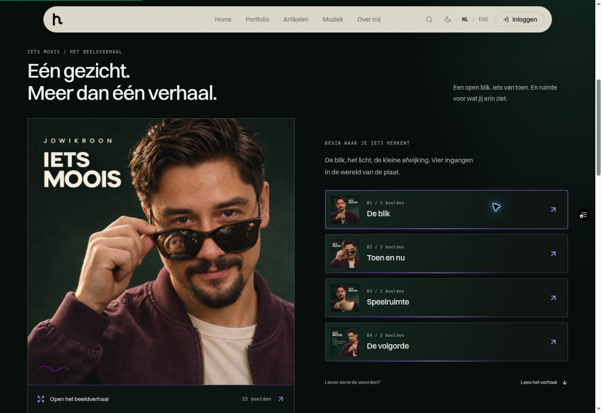
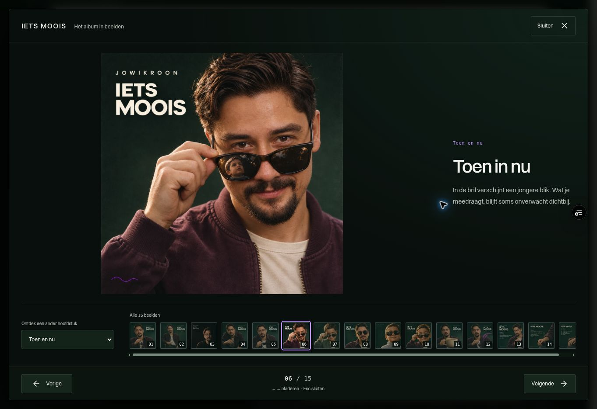

# IETS MOOIS: review van het complete beeldverhaal

Datum: 5 november 2026. Status: **preflight afgerond**. Definitieve CI, productiemerge en livecontrole staan nog open; het publicatiebewijs wordt bijgehouden in [PR #485](https://github.com/jowikroon/hans-crafted-stories/pull/485).

De uitbreiding presenteert alle 15 verschillende aangeleverde beelden via vier hoofdstukken, neonknoppen en één overlay. Ieder beeld krijgt maximaal twee korte Nederlandse zinnen. Drie afbeeldingen met liedtitels blijven herkenbaar als volgordestudies.

Dit register volgt de gevraagde verdeling: **30 ontwerp- en bouwcontroles, 10 stresstests en 20 herstelcontroles**. Het zijn 60 afgebakende controles, uitgevoerd met verschillende methoden; geen 60 onafhankelijke gebruikersonderzoeken. **Gereed** betekent dat de genoemde methode is uitgevoerd, **deels** dat een expliciet onderdeel resteert, en **open** dat uitvoeringsbewijs nog ontbreekt.

## Bewijs en grenzen

- Gerichte componentcontrole: **25 tests geslaagd in 6,90 s** in Vitest/jsdom met MemoryRouter. Dit omvat grensbediening, retryfocus, bestaande afbeeldingslinks en twee overgenomen regressies voor late achtergrondcontrols, inert-opruiming en behoud van een al bestaande inert-status. De volledige CI-uitvoering bevestigt dezelfde 25 gallerytests.
- Native desktopcontrole op `7f94460`: Chromium, 1363×936 CSS-pixels, alle 15 beelden geladen. Deze controle vond 20 px onnodige verticale overflow en focusverlies bij een native uitgeschakelde eindknop. Hercontrole van de volledige pagina op `ebdc4e5` bij dezelfde afmetingen bevestigt nul interne overflow, behouden focus op beide grensknoppen en Escape naar de exacte opener met herstelde paginascroll.
- Native volledige-paginacontrole op `7cf7c70`: app-root inert tijdens openen, dialoogportaal niet inert, focus op Sluiten en vergrendelde paginascroll. Een directe link sloot op dezelfde route en herstelde focus; twaalf echte open/End/Home/Escape-cycli over alle vier hoofdstukken lieten telkens nul dialogen, een niet-inerte root, zichtbare paginascroll, een lege query en de exacte opener met focus achter. Later verschenen consentknoppen stonden beide binnen de inerte root en werden na sluiten weer beschikbaar. Aanvullende lifecycle- en eerdere-inertscenario's zijn afzonderlijk in jsdom gecontroleerd.
- Responsive controles op `ebdc4e5`, `7cf7c70` en de laatste correctie `7018e9b`: het werkelijke component en de stylesheet in een tijdelijke, geïsoleerde browserfixture met vaste CSS-afmetingen. Dit controleert de componentlayout; het emuleert geen telefoon en bewijst geen volledig mobiele paginanavigatie.
- Gemeten afmetingen: 320×568, 360×640, 390×844, 768×1024, 1280×800, 844×390 en 568×320. Geen horizontale documentoverflow; sluiten en bladeren bleven bereikbaar. De laatste hercontrole op `7018e9b` toont bij 568×320 het volledige beeld van 154×154 px met de caption ernaast. Bij 844×390 past het beeld van 180×180 px met caption; die regels zijn sinds de meting op `7cf7c70` ongewijzigd. Alle vier labels passen op 320 px op één regel, in even hoge kaarten van 129,4 px.
- Echte browserklikken op opnieuw proberen bij 320×568 en 568×320 herstelden fixture-afbeeldingsfouten en hielden focus op het benoemde beeldgebied. Bij 568×320 bleef 9 px interne scroll bestaan en was het herstelde beeld volledig zichtbaar; er wordt voor die proef geen scroll-nulresultaat geclaimd. Dit was geen onderbroken productienetwerkverbinding.
- Volledige CI op `7cf7c70` geslaagd: **49 testbestanden, 486 tests**, inclusief de 25 gallerytests; vier aanvullende suites met 24, 4, 5 en 6 tests slagen ook. Lint: nul fouten en 19 bestaande waarschuwingen. Personal-, SaaS- en thought-canvas-jobs slagen; de afzonderlijke CodeQL-resultaatcheck meldt nul nieuwe alerts.
- De productiebuild na de laatste landscapeverfijning en volledige verwijdering van de openbare reviewfixture slaagt op 5 november, 01:58 UTC: SEO-guard 70 pagina's; image-guard 71 pagina's, 83 unieke afbeeldingen en nul fouten; eager JavaScript 419 kB gzip bij een budget van 425 kB. De opgeschoonde bron en uitvoer bevatten geen reviewpagina of fixturebundels. De releasecommit krijgt nog zijn eigen CI-uitvoering.
- Het volledige bronmanifest van 1.225 repositorybestanden is vóór en na de build gelijk, nadat uitsluitend de automatisch gegenereerde sitemap naar de oorspronkelijke bytes is teruggezet. Alle dertig nieuwe afbeeldingen zijn bytegelijk in bron en build; ook de acht bestaande openbare afbeeldingsbestanden zijn bytegelijk aan main en de build. De gebouwde verhaalroute heeft één module, één beeldenanker en vier hoofdstukknoppen.
- De expliciete volledige app-TypeScriptcontrole na de inert-aanvulling heeft dezelfde **255 bestaande diagnostieken** als de basisversie, met bytegelijke logs en nul nieuwe regels. Gerichte lint en diffcheck slagen. De volledige app-typecheck zelf blijft daarmee ongeslaagd; de bronkoppeling en uiteindelijke publicatiecontrole worden afzonderlijk vastgelegd.

De native browserwaarnemingen, responsive geometrie en foutherstel zijn afzonderlijk geregistreerd. Er is geen test met fysieke apparaten, Mobile Safari, een screenreader, echte browserzoom, OS-contrastvoorkeuren, netwerkvertraging of proefpersonen uitgevoerd. CSS-regels en gesimuleerde touch-events bewijzen die omstandigheden niet.

Een aanvullende automatische Codex-review kon niet worden uitgevoerd doordat het gebruiksquotum was bereikt. Die poging levert geen aanvullende codereview op; de uitgevoerde tests en CodeQL-resultaten staan hierboven afzonderlijk beschreven.

## Vastgelegde desktopbeelden

Deze twee screenshots tonen de werkelijke preview van `7cf7c70ed022c9c1ddfe005310b12eed4ead1dde`, bekeken op 1363×936 CSS-pixels. Ze leggen het overzicht en de open overlay van dat checkpoint vast; ze zijn geen bewijs van de latere landschapscontrole of productiepublicatie.

## A. Ontwerp en bouw: 30 controles

| Nr. | Controle | Methode en status | Uitkomst |
| ---: | --- | --- | --- |
| 01 | Opdracht en beeldrichting | Bronreview · gereed | De actuele aangeleverde IETS MOOIS-beelden bepalen de presentatie. |
| 02 | Plaats op de verhaalroute | Bronreview · gereed | Beeldverhaal na de korte hero; verhaaltekst blijft via een gewone link bereikbaar. |
| 03 | Bestaande navigatie | Bronreview · gereed | Het bestaande beeldenanker blijft `#album-world`, met één doel. |
| 04 | Herkenbare keuzes | Ontwerp/bronreview · gereed | Vier benoemde hoofdstukknoppen tonen miniatuur, titel en aantal beelden. |
| 05 | Dialoogbasis | Code-inspectie · gereed | Bestaande Radix-primitieven dragen de modale interactie. |
| 06 | Compositie en leestempo | CSS/bronreview · gereed | Volledige vierkante beelden, `object-fit:contain`, geen automatische beeldwissel. |
| 07 | Toetsenbordmodel | Ontwerp/bronreview · gereed | Zichtbaar sluiten, Escape, begrensd bladeren en focusherstel zijn uitgewerkt. |
| 08 | Geschiedenismodel | Ontwerp/bronreview · gereed | Openen voegt één stap toe; beeldwissels vervangen die stap en behouden query/hash. |
| 09 | Neon en leesbaarheid | Kleurberekening/CSS · gereed | Helder UI-violet onderscheidt tekst/focus van decoratieve gloed; contrastberekeningen zijn beoordeeld. |
| 10 | Mobiele opbouw | CSS-review · gereed | Sluiten en bladeren staan buiten het interne scrollvlak; dynamische hoogte en veilige randen zijn voorzien. |
| 11 | Aangeleverde bestanden | Bestandscontrole · gereed | Alle 20 PNG-bestanden zijn aanwezig en decodeerbaar. |
| 12 | Exacte duplicaten | Bestands- en pixelhashes · gereed | Vijf exacte herhalingen verwijderd; alle 15 verschillende beelden behouden. |
| 13 | Beeldinhoud | Visuele inspectie · gereed | Vijf portretten, vijf spiegelstudies, twee speelse beelden en drie volgordestudies beoordeeld. |
| 14 | Hoofdstukken en opener | Redactie · gereed | Verdeling 5/5/2/3; het portret met de jonge spiegeling vormt de uitnodiging. |
| 15 | Korte bijschriften | Redactie/validatie · gereed | Elk beeld heeft twee korte Nederlandse zinnen; hoofdstukintro's zijn beperkt tot één zin. |
| 16 | Voorlopige liedvolgorde | Datareview · gereed | Alle drie volgordebeelden benoemen een voorstel of studie. |
| 17 | Webexports | Encoding · gereed | Vijftien volledige WebP's van 1254×1254 en vijftien miniaturen van 320×320 gemaakt. |
| 18 | Exportkwaliteit | Visuele inspectie · gereed | Miniaturen en volledige hero-/volgorde-exports gecontroleerd op compositie en ingebakken letters. |
| 19 | Datakoppelingen | Programmatische validatie · gereed | Vijftien unieke IDs, dertig geldige paden, passende covers en correcte hoofdstukaantallen. |
| 20 | Integriteit en omvang | Hashes/decodering · gereed | Originelen ongewijzigd; exports opnieuw gedecodeerd. De dertig nieuwe assets tellen 2.738.262 bytes. |
| 21 | Route-integratie | Implementatie/bronreview · gereed | Alleen IETS MOOIS krijgt de module; bestaande verhaal- en luisteronderdelen blijven aanwezig. |
| 22 | Neonknoppen | Implementatie/CSS · gereed | Dunne violette accenten, duidelijke labels en een afzonderlijke zichtbare focusrand. |
| 23 | Overlaybediening | Implementatie/bronreview · gereed | Benoemde dialoog, sluiten, vorige/volgende, hoofdstukkeuze, miniaturen en teller aanwezig. |
| 24 | Labels bij beelden | Data/implementatie · gereed | Alttekst, titel, hoofdstuk en caption horen bij hetzelfde beeld; studies krijgen een voorstelmelding. |
| 25 | Directe afbeeldingslinks | Implementatie/bronreview · gereed | Geldige `beeld`-IDs openen de overlay; ongeldige waarden openen geen lege dialoog. |
| 26 | Bedieningsvormen | Implementatie/bronreview · gereed | Buttons, pijlen, Home/End, hoofdstukkeuze, miniaturen en horizontale touch-gebaren ondersteund. |
| 27 | Laden en fouten | Implementatie/bronreview · gereed | Preview, laadstatus, foutmelding en opnieuw proberen; sluiten en bladeren blijven beschikbaar. |
| 28 | Typografie en voorkeuren | CSS-review · gereed | Bestaande sitefonts behouden; eigen portaalkleuren, reduced-motion- en forced-colors-regels toegevoegd. |
| 29 | Gerichte regressietests | Vitest/jsdom · gereed | Gerichte run: 25 componenttests in 6,90 s; volledige CI bevestigt ze binnen 486 tests. Simulatiegrenzen staan in de testcode. |
| 30 | Productiebuildcheckpoint | Build/artefactcontrole · gereed | Historische build en guards geslaagd; dit is geen goedkeuring van de uiteindelijke publicatie. |

## B. Stresstests: 10 controles

| Nr. | Controle | Methode en status | Uitkomst of resterend werk |
| ---: | --- | --- | --- |
| 31 | Alle beelden en grenzen | jsdom/native desktop · gereed | Vijftien beelden doorlopen. Native 14→15 en Home→1 behouden de grens; Enter op beide grensknoppen verandert het beeld niet. |
| 32 | Focus insluiten en herstellen | jsdom/native desktop · gereed | Shift+Tab/Tab gecontroleerd. Hercontrole houdt Volgend/Vorig beeld gefocust met `aria-disabled=true`; Escape herstelt de exacte opener en paginascroll. |
| 33 | Herhaald openen en snel bladeren | jsdom/native desktop · gereed | Twaalf echte open/End/Home/Escape-cycli over alle vier hoofdstukken: exacte openerfocus, nul achtergebleven dialogen, root niet inert, paginascroll vrij en query leeg. |
| 34 | Smalle portretweergave | Geïsoleerde browserfixture · gereed | 320/360/390 px zonder horizontale overflow. Na herstel passen op 320 px alle vier labels op één regel in gelijke kaarten van 129,4 px. |
| 35 | Lage landscape en leesbaarheid | Geïsoleerde browserfixture · gereed | Bij 568×320 past 154×154 px artwork met caption ernaast; bij 844×390 past 180×180 px artwork met caption. Native zoom is niet getest. |
| 36 | Bewegings- en contrastvoorkeuren | CSS/contrastreview · gereed | CSS- en contrastreview afgerond; werkelijk door OS-voorkeuren gestuurd rendergedrag is niet getest. |
| 37 | Beeldfout, retry en cache | jsdom/browserfixture · gereed | Opnieuw proberen herstelt het beeld en behoudt focus; sluiten en verder bladeren blijven beschikbaar. |
| 38 | Back/Forward en directe links | MemoryRouter/native desktop · gereed | Eén geschiedenisstap; Back sluit, Forward heropent. Vier bestaande afbeeldings-IDs hebben regressietests. |
| 39 | Touch-gebaren onderscheiden | Gesimuleerde events · gereed | Horizontale swipe werkt; verticale, korte, gecancelde, multitouch- en ingezoomde gebaren wisselen niet. |
| 40 | Achtergrond en consent | Native desktop/jsdom · gereed | Ook later verschenen consentknoppen staan native binnen de inerte root; portaal blijft bedienbaar. Sluiten herstelt achtergrond, scroll en focus; jsdom dekt lifecycle/eerdere inert-status. |

## C. Herstel en eindcontrole: 20 controles

| Nr. | Controle | Methode en status | Uitkomst of resterend werk |
| ---: | --- | --- | --- |
| 41 | Benoemde hoofdstukgroep | Wijziging/bronreview · gereed | De dialoogopeners vormen nu een benoemde groep. |
| 42 | Volledige collectie herkenbaar | Wijziging/bronreview · gereed | “Alle 15 beelden” maakt doorbladeren buiten het gekozen hoofdstuk expliciet. |
| 43 | Scroll na beeldkeuze | jsdom/browserfixture · gereed | Selectie herstelt interne scroll naar nul; ook waargenomen bij 320 px. |
| 44 | Focus vanuit de miniaturen | jsdom/browserfixture · gereed | Selectie brengt focus naar het benoemde beeldgebied; vaste bladerknoppen behouden hun focus. |
| 45 | Actieve miniatuur herselecteren | jsdom · gereed | Opnieuw kiezen van hetzelfde beeld herstelt focus en interne scroll. |
| 46 | Stabiele laadcallback | Code-inspectie · gereed | De ready-callback blijft stabiel zolang de geselecteerde afbeeldings-ID gelijk blijft. |
| 47 | Sluiten en scrollherstel | jsdom/native desktop · gereed | Escape geeft focus terug aan de opener; leespositie en eerdere scrollRestoration worden hersteld. |
| 48 | Direct-linkexit en oude IDs | MemoryRouter/native desktop · gereed | Native directe link sluit op dezelfde route, wist de beeldquery en herstelt root/fallbackfocus. Tests behouden overige query/hash en vier eerdere IDs. |
| 49 | Status van volgordestudies | Data/DOM-validatie · gereed | Alle drie volgordebeelden tonen hun voorlopige karakter in data en overlay. |
| 50 | Captioncontract herlezen | Redactie/DOM-tests · gereed | Alle captions voldoen aan maximaal twee zinnen; titel, beeld en tekst blijven gekoppeld. |
| 51 | Publiekscopy beoordelen | Bronreview · gereed | Tekst gaat over de zichtbare beelden en ontwerpprincipes; er worden geen nieuwe releaseclaims toegevoegd. |
| 52 | Exportintegriteit herhalen | Hashes/decodering · gereed | Originelen, uitvoermaten en alle dertig exports opnieuw gecontroleerd. |
| 53 | Gebouwde assets vergelijken | Artefact-hashes · gereed | Na de eindbuild zijn alle dertig nieuwe bron-/dist-assets bytegelijk; de acht oude afbeeldings-URLs behouden exact de bytes van main. |
| 54 | Gesloten overlay licht houden | jsdom/bronreview · gereed | Gesloten pagina bevat alleen hero en vier ingangsminiaturen; de volledige overlay is niet gemount. |
| 55 | Voorladen begrenzen | Code-inspectie · gereed | Alleen het volgende beeld na ready; Save-Data en een verborgen document stoppen voorladen. Geen gemeten netwerkprofiel. |
| 56 | Foutherstel in echte layout | Browserfixture · gereed | Retry blijft 44 px hoog en bereikbaar in beide landscapes. Native 568×320-retry herstelt het beeld en figuurfocus met 9 px resterende scroll; eerdere 320×568-proef herstelde scroll nul. |
| 57 | Compositie na layoutfixes | Native desktop/browserfixture · gereed | Desktop zonder onnodige interne overflow; beide korte landscapes tonen beeld en caption volledig. De vier 320px-labels passen op één regel. |
| 58 | Definitieve build en guards | Build/artefactcontrole · gereed | Opgeschoonde eindbuild slaagt: webroot/SEO/image/bundle groen, 419/425 kB gzip. Bronmanifest gelijk na sitemapherstel; geen openbare fixture in bron of uitvoer. |
| 59 | Finale lint, diff en typecheck | Uitvoering/vergelijking · gereed | Gerichte lint/diff exit 0 en 25 tests geslaagd; expliciete appcontrole na inert-aanvulling bytegelijk baseline: 255 bestaande diagnostieken, nul nieuwe. |
| 60 | Definitieve preview en publicatie | Eindcontrole · deels | Preview, main-reconciliatie en schone build afgerond. Definitieve release-CI/CodeQL, productiemerge/deploy en alle vijftien livebeelden worden nog geverifieerd en vastgelegd in [PR #485](https://github.com/jowikroon/hans-crafted-stories/pull/485). |

## Inspecteerbare bron en vervolg

De implementatie staat in [AlbumVisualStory.tsx](../../apps/personal/src/components/music/AlbumVisualStory.tsx), de inhoud in [albumVisualStory.ts](../../apps/personal/src/data/albumVisualStory.ts), de presentatie in [album-visual-story.css](../../apps/personal/src/styles/album-visual-story.css) en de regressies in [AlbumVisualStory.test.tsx](../../apps/personal/src/components/music/AlbumVisualStory.test.tsx). [MusicAlbumBrand.tsx](../../apps/personal/src/pages/MusicAlbumBrand.tsx) bepaalt de route-integratie.

De eerdere vier-beeldenreview blijft als geschiedenis behouden. Bestaande afbeeldings-URLs en de vier directe beeldlinks moeten na de uitbreiding blijven werken. De aanvullende achtergrondisolatie uit de inmiddels samengevoegde versie is overgenomen en native gecontroleerd; twee regressietests dekken daarnaast late controls en behoud van een bestaande inert-status.

De preflightcontroles zijn afgerond; de beschreven grenzen van de gebruikte methoden blijven gelden. De tijdelijke browserfixture en haar bundels zijn uit de publicatiebron en gebouwde uitvoer verwijderd. De laatste publicatiecontrole bij regel 60 blijft open totdat de releasecommit, CodeQL-resultaatcheck, productiedeploy en echte productiepagina zijn geverifieerd; [PR #485](https://github.com/jowikroon/hans-crafted-stories/pull/485) bewaart die uitkomst.
