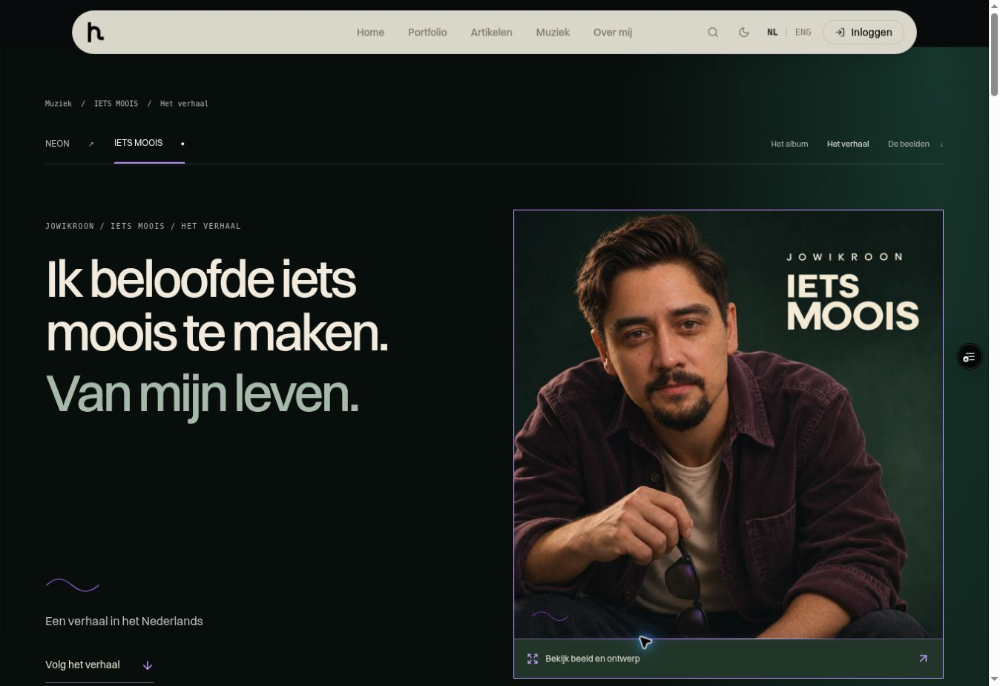
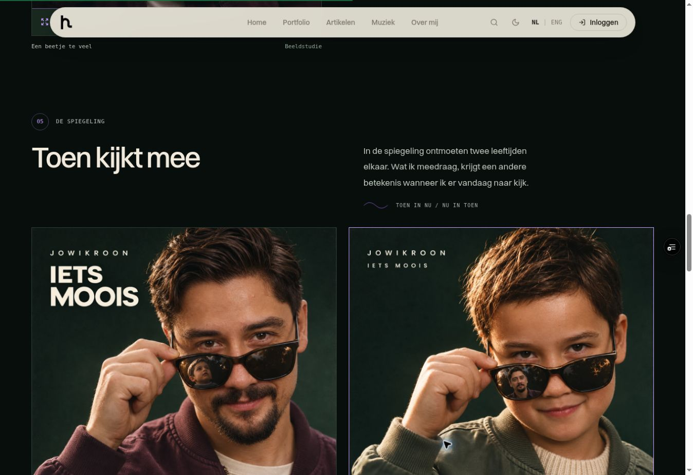
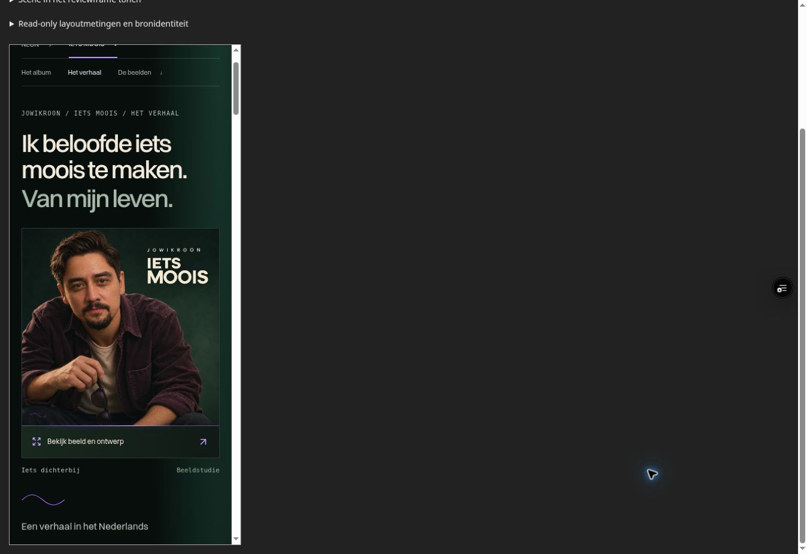
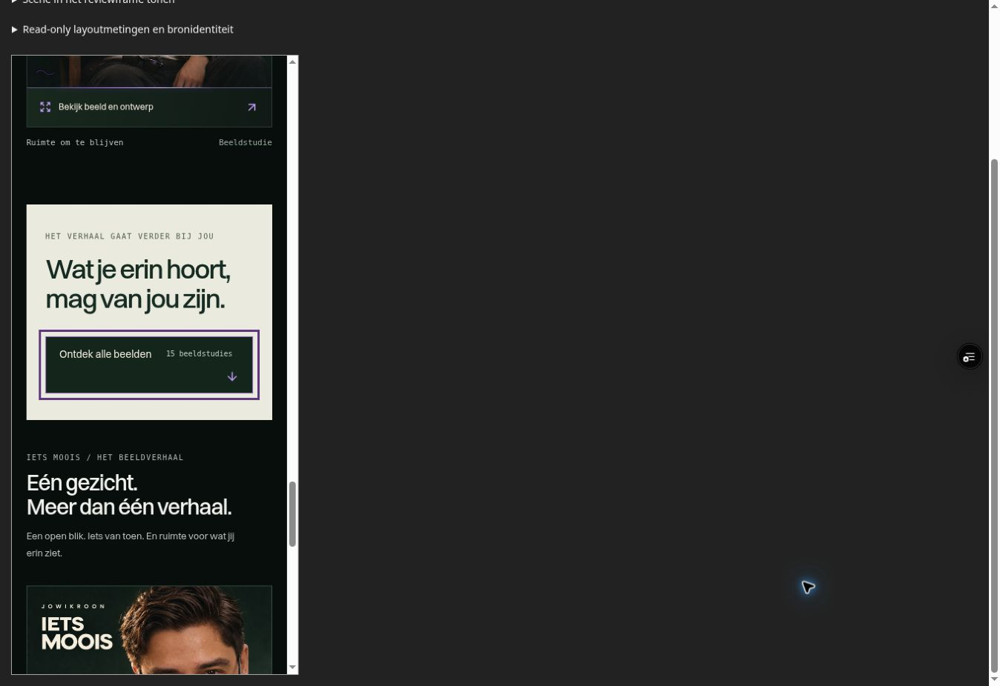

# IETS MOOIS: een doorlopend visueel verhaal

Datum: 5 november 2026. Route: `/music/albums/iets-moois/brand`.

De opdracht was om het volledige albumverhaal zichtbaar over de pagina te vertellen, met beeld voorop, maximaal twee lopende zinnen per visueel moment en behoud van de neonknoppen met optionele beeldverdieping. Vijf afzonderlijke agents beoordeelden ieder tien afgebakende onderwerpen. De hoofdagent voerde de implementatie en native browserbediening uit en verzorgt de publicatiecontrole.

De vijftig hieronder vastgelegde rondes zijn expertbeoordelingen en gerichte verfijningen. Het zijn geen vijftig volledige builds, deployments of onderzoeken met echte bezoekers. De eerste zeven rondes per rol betreffen de uitgangssituatie en het ontwerp; de laatste drie toetsen de implementatie en het beschikbare bewijs.

## Het verhaal op de pagina

De opening maakt de belofte meteen zichtbaar: **Ik beloofde iets moois te maken. Van mijn leven.** Het voorovergeleunde portret nodigt uit om dichterbij te komen. De korte aanduiding blijft **Een verhaal in het Nederlands**.

| Moment | Verhaaltekst | Beeld |
| --- | --- | --- |
| Toen: Ooit was weten genoeg | Er was een tijd waarin de wereld nog vanzelf leek te kloppen. De verwondering van toen reist met me mee, ook nu er meer vragen zijn. | Vooruitkijken |
| De stilte: Wat weg is, klinkt door | Later kwamen de vragen, en bleef soms juist het ongezegde hangen. In mijn eigen taal zoek ik woorden voor gemis, spijt en schaamte. | Een beetje licht |
| De tegenstem: Er mag iets dwarszitten | Ik laat de twijfel meepraten, ook wanneer het over liefde gaat. Soms met een dwarse vraag, soms met een lach om iets dat net te groot uitvalt. | Een beetje te veel |
| De spiegeling: Toen kijkt mee | In de spiegeling ontmoeten twee leeftijden elkaar. Wat ik meedraag, krijgt een andere betekenis wanneer ik er vandaag naar kijk. | Toen in nu + Nu in toen |
| Vandaag: Van wat er nu is | De belofte krijgt vorm in wat ik vandaag doe: iemand toelaten, blijven, iets teruggeven. In deze liedjes probeer ik te begrijpen wie ik nu ben. | Ruimte om te blijven |

Het zelfstandige slot is **Wat je erin hoort, mag van jou zijn.** Daarna volgt de bestaande collectie van vijftien beeldstudies. De vijf lopende passages bevatten respectievelijk 26, 23, 27, 20 en 25 woorden: 121 woorden, telkens twee zinnen. Het spiegelingspaar deelt een passage.

## Wat is veranderd

- Alle zes verhaalhoofdstukken staan in de normale leesvolgorde, ook in de eerste HTML. De oude oorsprongsalinea's en verborgen verhaal-tabs worden voor IETS MOOIS door deze leesroute vervangen.
- Zeven bestaande beelden dragen het verhaal. Ze behouden hun volledige vierkante compositie; de tekst staat naast of onder het beeld.
- Een hoofdstukindex met gewone ankerlinks ondersteunt gericht lezen. De bestaande bestemmingen `album-origin`, `album-spoor` en `album-world` blijven beschikbaar.
- Alle zeven beeldknoppen gebruiken dezelfde bestaande gallerycontroller. Sluiten keert terug naar de betreffende scèneknop, met behoud van de hoofdstukhash en leespositie.
- De lichtgekleurde afsluiting heeft een donkerpaarse toetsenbordfocus. Een lange regel in de verwijzing naar NEON kan op het smalste scherm met vergrote tekst afbreken.
- Het verhaal voegt geen release-, trackvolgorde- of audiobeschikbaarheidsclaim toe. De slotnavigatie heet voor IETS MOOIS daarom `Verder ontdekken`.

## Ronden 01–10: bronnen en publiceerbare inhoud

Agent: `narrative_sources`.

| Ronde | Beoordeling en beslissing | Controle |
| --- | --- | --- |
| 01 | Zet de bestaande concrete belofte vóór de abstracte beeldverkenning. | Volgorde van de oude pagina en het goedgekeurde publieke anker gelezen. |
| 02 | Houd de tekst binnen het goedgekeurde publieke verhaal. | Bronhiërarchie en publicatiegrens gecontroleerd; geen nieuwe privébiografie toegevoegd. |
| 03 | Maak de hoofdlijn zichtbaar bij gewoon scrollen. | Bestaande verborgen tabpanels vastgesteld; vervangen door zichtbare scènes. |
| 04 | Behandel de spiegelbeelden als beeldstudies. | Vijftien beeldrecords nagekeken; geen documentaire jeugdclaim. |
| 05 | Laat humor, twijfel en gemis naast elkaar bestaan. | Bestaande albumtekst vergeleken; geen verzonnen emotionele oplossing. |
| 06 | Verdeel de tekst over korte visuele momenten. | Oude alinea's geteld; definitieve tweezinnenpassages gecontroleerd in ronde 09. |
| 07 | Houd verhaalvolgorde en trackliststudies uit elkaar. | De drie verschillende voorstellen blijven als studies herkenbaar. |
| 08 | Lees alle nieuwe copy terug tegen de publieke bron. | Belofte behouden; geen nieuwe concrete levensgebeurtenis of dialoog. |
| 09 | Controleer de definitieve tekst-beeldkoppeling. | Vijf passages, twee zinnen per passage, 121 woorden en zeven unieke beelden. |
| 10 | Vermijd een onjuiste luisterbelofte in de sluitnavigatie. | `Verder luisteren` is alleen voor IETS MOOIS gewijzigd naar `Verder ontdekken`. |

## Ronden 11–20: beeldregie en visuele uitvoering

Agent: `visual_direction`.

| Ronde | Beoordeling en beslissing | Controle |
| --- | --- | --- |
| 11 | Geef het narratief een eigen zichtbare leesroute. | Bestaande pagina- en componentvolgorde beoordeeld. |
| 12 | Geef elk gekozen beeld een eigen functie in het verhaal. | Belofte, verwondering, stilte, humor, spiegeling en vandaag gekoppeld. |
| 13 | Bescherm de composities en ingebouwde covertypografie. | Volledige vierkante beelden, geen tekstlaag over de artwork. |
| 14 | Wissel het desktopritme af met een eenvoudige mobiele leesvolgorde. | Kolommen, DOM-volgorde en stapeling van het spiegelingspaar beoordeeld. |
| 15 | Houd elk visueel moment kort en onderscheidend. | Geen herhaalde oorsprongsalinea of tweede slotpassage. |
| 16 | Gebruik neon als herkenbare bediening. | Dezelfde korte beeldactie, duidelijke hover/focus en rustige accenten. |
| 17 | Laat verdieping optioneel en beperk het eerste laadwerk. | Eén eager openingsbeeld; overige beelden lazy met vaste intrinsieke maten. |
| 18 | Vergelijk de implementatie met de afgesproken beeldregie. | Zes hoofdstukken, zeven volledige beelden en één gedeelde gallery. |
| 19 | Bekijk echte desktopbeelden en de eerste twaalf reflowmetingen. | Hero en spiegelingspaar beoordeeld; één companionregel bij 320px/2× tekst gemeld. |
| 20 | Toets de correctie en mobiele presentatie. | Laatste twaalf metingen zonder tekstgrenssignalen; mobiele hero en focusafsluiting visueel beoordeeld. |

## Ronden 21–30: UX, oriëntatie en toegankelijkheid

Agent: `ux_narrative`.

| Ronde | Beoordeling en beslissing | Controle |
| --- | --- | --- |
| 21 | Het complete kernverhaal moet zonder extra keuze leesbaar zijn. | Normale documentvolgorde; geen autoplay of verplichte scène-interactie. |
| 22 | Behoud begrijpelijke oriëntatie en bestaande ankers. | Native hoofdstukindex en betekenis van drie bestaande bestemmingen gecontroleerd. |
| 23 | Geef beelden ritme zonder wisselende leesregels. | Tekst buiten artwork; mobiele volgorde en functioneel spiegelingspaar. |
| 24 | Laat de overlay terugkeren naar de juiste scène. | Eén controller met expliciete opener; losse querylinks als scène-ingang afgewezen. |
| 25 | Pas de twee-zinnenregel toe op het gehele visuele moment. | Hero niet uitgebreid; vijf korte passages en afzonderlijk slot. |
| 26 | Laat kleine schermen en grote tekst de layout bepalen. | Inhoudsafhankelijke hoogte, wrappende index, volledige beelden en flexibele kolommen. |
| 27 | Houd de hoofdlijn beschikbaar als verdieping niet werkt. | Scènes in statische HTML; geen animatie-afhankelijke zichtbaarheid. |
| 28 | Controleer de nieuwe bron en focuskleuren. | Lichtvlak-focus verbeterd van berekend 1,75:1 naar 7,57:1 contrast. |
| 29 | Beoordeel het nieuwe interactiepad en de tests. | Vijf nieuwe integratietests plus 52 bestaande gallery/actiontests gelezen; 57 geslaagd. |
| 30 | Verifieer native terugkeer, reflow en focusbewijs. | Exacte terugkeer bij toetsenbord/geschiedenis; twaalf passende layouts; zichtbare 3px focusrand. |

## Ronden 31–40: narratief en redactie

Agent: `narrative_copy`.

| Ronde | Beoordeling en beslissing | Controle |
| --- | --- | --- |
| 31 | Laat de belofte zelfstandig de opening dragen. | Extra heroalinea verwijderd; exacte tweeregelige H1 behouden. |
| 32 | Verbind de verwondering van toen met het perspectief van nu. | Twee zinnen; geen persoon, plaats, datum of documentaire fotoclaim. |
| 33 | Geef de stilte een eigen functie en verklaar de eigen taal. | Gemis, spijt en schaamte sluiten aan op de bestaande publieke tekst. |
| 34 | Laat humor adem geven zonder het gemis op te lossen. | Ik-stem en oversized kop gekoppeld zonder extra levensverhaal. |
| 35 | Schrijf de spiegeling als relatie tussen perspectieven. | Eén passage bij het tweeluik, zonder biografische bewijsclaim. |
| 36 | Keer terug naar de belofte met keuzes in het heden. | `Probeer` bewaart openheid; zelfstandige slotzin buiten de scène. |
| 37 | Lees de hele route als één verhaal. | Geen dubbel oorsprongsblok; bediening en beschrijvende alt-tekst blijven apart. |
| 38 | Controleer alle toegepaste tekst in de paginaroute. | Exacte passagevergelijking, 121 woorden, juiste H1-spatie en geen dubbele afsluiting. |
| 39 | Controleer de uiteindelijke beeld-tekstrelatie. | Gekozen beelden en contactbladen beoordeeld; publieke inhoudsgrens behouden. |
| 40 | Lees het gerenderde verhaal en bekijk de echte composities. | Desktophero, spiegelingspaar, mobiele hero, slot en volledige DOM-tekst beoordeeld. |

## Ronden 41–50: interactie en regressierisico

Agent: `interaction_review`.

| Ronde | Beoordeling en beslissing | Controle |
| --- | --- | --- |
| 41 | Houd één eigenaar voor openen, sluiten en focus. | Kleine render-prop naar de bestaande gallerycontroller. |
| 42 | Onderscheid de leesscène van het gekozen gallerybeeld. | Hoofdstukhash blijft; openen PUSH, bladeren REPLACE en legacylinks behouden. |
| 43 | Behoud leespositie op de langere pagina. | Bestaande openercompensatie en intrinsieke afbeeldingsmaten beoordeeld. |
| 44 | Zet de volledige hoofdlijn in de eerste HTML. | SSR-regressieproef controleert alle scènes en zeven openers. |
| 45 | Gebruik native, benoemde bediening. | Buttons voor dialogs, links voor hoofdstukken en geen extra Tab-stops op secties. |
| 46 | Maak herschikking onderdeel van de interactiecontrole. | Wrapping, minmax-kolommen, volledige beelden en stapelend paar. |
| 47 | Begrens betekenis en laadwerk. | Bestaande assets en iconen; één eager beeld; hoofdstukken zijn geen tracks. |
| 48 | Controleer de geïmplementeerde componenten. | Niet-ondersteunde React18-prop verwijderd; H1-spatie en gedeelde controller teruggelezen. |
| 49 | Voer gerichte regressieproeven uit. | Vijf nieuwe tests; samen met bestaande gallery/actiontests 57/57 geslaagd. |
| 50 | Toets het echte browserbewijs onafhankelijk. | Native Tab/Enter/Rechts/Escape en Vooruit/Terug herstellen dezelfde opener, hash en pixelpositie. |

## Bewijs en grenzen

De volledige personal-testsuite slaagde met **518 tests in 51 bestanden**. Vijf daarvan zijn nieuwe integratietests voor deze scène-ingangen. De bestaande gallerytests blijven behouden. De standaard persoonlijke typecheck slaagde. De expliciete app-typecheck heeft 255 bestaande diagnostics, exact gelijk aan de vastgelegde baseline; die ruimere check is dus niet foutvrij.

De definitieve schone build voltooide op 5 november 2026 om 10:28:53 UTC met exitcode 0. Alle zes taakbronhashes bleven gelijk; de tijdelijke reviewbestanden ontbreken in public en dist. De webrootcontrole slaagde, de SEO-controle valideerde 70 pagina's met 27 controles, de beeldcontrole vond nul fouten bij 94 unieke beelden en de eager JavaScript bleef met 421 kB gzip onder het budget van 425 kB.

De native toetsenbordreeks op preview `733c38003a2317eb922e41a0040d237ddf2aa59d` behield `#album-stilte`, `scrollY = 1799` en de opener op `223,09375px`, vóór openen, tijdens openen en na sluiten. Vooruit/Terug heropende het laatst gekozen beeld en herstelde opnieuw dezelfde positie en focus. De controller en relevante componentbron zijn sindsdien ongewijzigd. Een eerdere locatorgestuurde proef verplaatste de opener al vóór activering; dat is onderzocht en niet als productfout of productfix geboekt.

De laatste reflowcontrole gebruikt preview `6239a4fa4a718d07e60e92f5de1160ad86ba78da` en bron-digest `e89dbdf230998d0b8a607604fce2d75567a911e35207a066522408234381dd4b`. De zes CSS-vensters zijn 320×568, 390×844, 568×320, 844×390, 768×1024 en 1363×936, ieder met normale en verdubbelde lettergroottes. Alle twaalf bevatten zes hoofdstukken en zeven beelden, zonder horizontale pagina-overflow of gemeten tekstgrenssignalen. De gereserveerde beeldvakken blijven vierkant en behouden `object-fit: contain`.

De 200%-case verdubbelt de authored CSS-lettergroottes. Dit is geen native browserzoom, OS-tekstvergroting of fysieke apparaattest. Het reviewframe gebruikt de echte albumcomponenten, maar omvat niet de globale sitekop, SEO-hooks of eigenaarspaneel. Ankerlandingen en geschiedenis zijn daarom op de echte previewroute apart gecontroleerd. Lazy beelden die nog niet in beeld zijn geweest worden als pending beschreven, niet als geladen of defect.

De afsluitende beeldlink heeft in de native focusmeting `focusVisible: true`, een massieve 3px rand in `rgb(93, 54, 125)` en een omringend vlak in `rgb(234, 234, 222)`. De mobiele screenshot bevestigt dat die rand zichtbaar blijft. De tijdelijke reviewfixture is vóór de release uit de public webroot verwijderd.

Er is geen claim van onderzoek met echte bezoekers, volledige screenreaderconformiteit, fysieke touchhardware, native zoom of een foutvrije ervaring op elk denkbaar apparaat. De gecontroleerde nieuwe lees- en gallerypaden hebben geen resterende blokkade laten zien.

De compacte meetreceipt en hashes staan naast dit verslag in `2026-11-05-iets-moois-narrative-evidence.json`. De definitieve publicatieresultaten worden in de PR-controles en het canonieke taaklog vastgelegd.

## Visueel bewijs uit de preview

De desktopbeelden komen van de echte previewroute; de mobiele opnamen tonen het beschreven CSS-reviewframe met de echte componenten.

